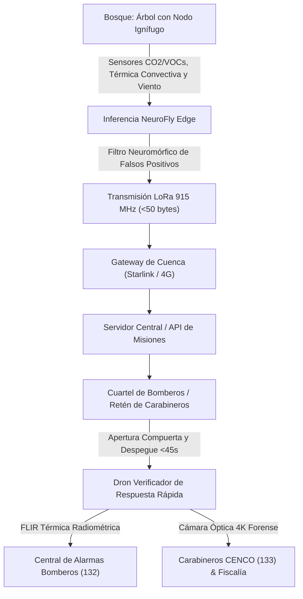

# 🌲 FLYBRIDGE v0.1 — Red de Nodos Arbóreos Ignífugos & Estación Drone-in-a-Box de Autoridades
### *La inteligencia de la naturaleza al servicio de un bosque más seguro*
**Detecta. Interpreta. Actúa.** Tecnología inspirada en el modelo neuromórfico NeuroFly (*Drosophila melanogaster*) para la prevención temprana, verificación autónoma y combate de incendios forestales.

---

## 📌 Visión General del Sistema

El sistema **FLYBRIDGE v0.1** combina el modelo computacional neuromórfico de **NeuroFly** ejecutándose en el borde (*Edge*) sobre una **malla de nodos sensores arbóreos ignífugos**, articulado con una estación automatizada **Drone-in-a-Box** operada directamente desde instalaciones protegidas de las autoridades competentes (**Cuarteles de Bomberos, Retenes de Carabineros de Chile o brigadas forestales de CONAF/SENAPRED**).

Este diseño reemplaza el patrullaje continuo aleatorio de drones en el aire por una arquitectura híbrida de máxima eficiencia energética y táctica:
1. **Detección continua 24/7 en el árbol**: Nodos ignífugos en reposo activo analizan microplumas de gases y gradientes térmicos convectivos.
2. **Despliegue rápido bajo demanda (<45 s)**: Solo cuando un nodo confirma una anomalía con alta probabilidad, la estación en el cuartel abre su compuerta motorizada y despacha el dron verificador a 75 km/h hacia las coordenadas exactas del árbol.
3. **Despacho operativo multiorganismo simultáneo**:
   - **Bomberos (132)**: Ficha táctica con ruta de acceso vehicular más expedita, fuentes de agua y proyección de avance del fuego según el viento del árbol y la radiometría FLIR.
   - **Carabineros CENCO (133)**: Alerta con capturas forenses ópticas 4K (vehículos, huellas, personas en fuga), firma criptográfica SHA-256, plan de cierre perimetral de rutas y entrega directa a la carpeta investigativa del Ministerio Público (Fiscalía).

---

## 🔄 Flujo Operativo Completo

```text
 [Bosque: Árbol]
   └── Nodos Ignífugos con Inferencia NeuroFly (Python / Edge)
        ├── Sensores: CO2/VOCs + Gradiente Térmico Multizona + Viento
        └── Filtro neuromórfico de falsos positivos (discriminación solar)
                 │
                 │ (Telemetría LoRaWAN / LoRa Mesh - 915 MHz | Paquete < 50 bytes)
                 ▼
      [Gateway de Cuenca / Enlace Satelital Starlink o 4G/LTE]
                 │
                 ▼
     [Servidor Central / API de Misiones & Triangulación]
                 │
                 ▼
 [Tenencia de Autoridades: Cuartel de Bomberos / Retén de Carabineros]
   ├── Base de Operaciones / Docking Station en Techo o Torre
   ├── Despegue Inmediato del Dron Verificador (<45 s)
   └── Panel de Monitoreo en Tiempo Real (CENCO / Central de Alarmas)
```



---

## 🔬 Los 4 Pilares Arquitectónicos

### 1. Inferencia Sensorial en el Árbol (NeuroFly Edge)
* **Ejecución Local en Python / MicroPython**: El modelo de NeuroFly corre en un procesador de ultra bajo consumo montado en el árbol (ej. Raspberry Pi Zero 2 W o microcontroladores Cortex-M4/RP2040).
* **Lóbulo Olfativo Neuromórfico**:
  - Calcula la tasa de cambio temporal de concentración de gases:
    $$\frac{dC}{dt} = \frac{C(t) - C(t - \Delta t)}{\Delta t}$$
  - Rastrea $CO_2$, $CO$ y Compuestos Orgánicos Volátiles ($VOCs$).
  - Detecta **microplumas de humo diluidas por el viento** mucho antes de que se alcancen concentraciones visibles o masivas en el dosel forestal.
* **Médula/Lámina Visual (Flujo Térmico Convectivo Multizona)**:
  - Mediante un arreglo vertical térmico diferencial, mide el gradiente térmico ascendente ($\Delta T = T_{sensor} - T_{ambiente}$).
  - Detecta patrones convectivos ascendentes y parpadeo térmico errático (*thermal flicker* de llama), distinguiendo una fuente de combustión real de la radiación solar normal sobre las hojas o el suelo.
* **Filtro Neuromórfico de Falsos Positivos**:
  - Compuerta de coincidencia biológica cruzada (*cross-modal coincidence gate*):
    * Si la copa se calienta por sol intenso sin $dC/dt$ de gas ni turbulencia térmica -> **Falso positivo rechazado (Calentamiento Solar)**.
    * Si hay un pico transitorio de gas sin calor ascendente (ej. escape de tractor) -> **Falso positivo rechazado (Escape Aislado)**.
    * Si coinciden $dC/dt > 1.8 \text{ ppm/s}$ + gradiente convectivo ascendente $> 8^\circ\text{C}$ -> **Ignición forestal confirmada con alta confianza**.
* **Emisión Eficiente LoRaWAN / LoRa Mesh (915 MHz)**:
  - Al confirmar una anomalía, emite un paquete binario estructurado de **32 bytes** (muy inferior al límite estricto de 50 bytes):
    * `ID Nodo` (uint16)
    * `Timestamp` (uint32)
    * `Latitud / Longitud` fijas (int32)
    * `Temp Ambiente y Gradiente Convectivo` (int16)
    * `dC/dt de Gas` (int16)
    * `CO2 ppm y VOC ppb` (uint16)
    * `Vector de Viento: Velocidad y Rumbo` (uint16)
    * `Nivel de Confianza % y Alerta` (uint8)
    * `Batería LiFePO4 % y CRC8` (uint8)

---

### 2. Infraestructura del Nodo Ignífugo
* **Resistencia Térmica**: Chasis hermético con polímeros retardantes de llama **UL94 V-0** y aleación de aluminio fundido con barrera cerámica externa resistente a temperaturas de hasta 600°C.
* **Ingreso de Gases**: Membranas hidrofóbicas de politetrafluoroetileno (**PTFE**) microporosas que permiten el flujo libre de aire y gases hacia los sensores químicos, repeliendo agua de lluvia, humedad, polvo y resinas vegetales.
* **Autonomía Energética Continua**: Celda **LiFePO4** (fosfato de hierro y litio, química químicamente estable que no experimenta fuga térmica ni explota ante calor extremo) complementada con un micro-panel solar monocristalino integrado, garantizando operación permanente en modo reposo activo con gestión inteligente de ciclo de trabajo (*duty-cycled sleep*).

---

### 3. El Dron en Tenencia de las Autoridades (Cuartel Oficial)
Ubicar la estación base en dependencias operativas de las autoridades (**Cuarteles de Bomberos de interfaz, Retenes de Carabineros rurales o bases de brigada CONAF**):
* **Seguridad y Mantenimiento**: El equipo permanece resguardado contra robo, sabotaje o vandalismo en un recinto oficial con vigilancia permanente, alimentación eléctrica de red estable (220V respaldada por UPS del cuartel) y asistencia logística del personal de guardia.
* **Despliegue Automatizado (Drone-in-a-Box)**:
  - La base montada en el techo o torre del recinto recibe la alerta vía API desde el servidor central en milisegundos.
  - La compuerta hermética motorizada se abre en menos de 15 segundos.
  - El dron realiza un chequeo pre-vuelo y despega de forma autónoma en **menos de 45 segundos (<45 s)**, siguiendo una ruta de vuelo precalculada a 75 km/h hacia el nodo que emitió la alerta.
* **Carga de Pago Especializada Dual**:
  1. **Cámara Térmica Radiométrica (FLIR)**:
     - Mide la temperatura exacta del núcleo (ej. 450°C - 750°C) y el perímetro del frente de fuego (metros).
     - Calcula la tasa de propagación y la intensidad lineal de llama (kW/m) para dimensionar los carros bomba de Bomberos.
  2. **Cámara Óptica 4K con Zoom 30x**:
     - Realiza un barrido perimetral de 360° en senderos, huellas de vehículos y vías de escape.
     - Detección algorítmica de vehículos sospechosos, huellas de tracción recientes y personas en fuga.
     - Generación de marca de tiempo y firma criptográfica **SHA-256** para validez pericial.

---

### 4. Integración y Despacho de Información Operativa

#### Central de Alarmas de Bomberos (132 / Brigadas Forestales CONAF):
* Coordenadas geográficas exactas (decimales y formato sexagesimal WGS84).
* **Ruta de acceso vehicular más expedita**: Nombre de pista forestal o cortafuego transitable para carros bomba 4x4, portón de acceso, distancia exacta en kilómetros y tiempo estimado de llegada (**ETA**).
* **Proyección del avance del fuego en tiempo real**: Cono elíptico de Huygens / Rothermel proyectado a 15, 30 y 60 minutos según el vector de viento medido en el árbol y la radiometría del dron.
* Identificación de fuentes de agua tácticas (tranques agrícolas, grifos de alta presión y ríos).

#### Comunicaciones de Carabineros (CENCO - 133):
* Alerta simultánea instantánea con registro fotográfico y de video georreferenciado en alta resolución 4K.
* **Plan de Cierre Perimetral de Rutas**: Puntos de control vehicular estratégicos en caminos vecinales para cortar vías de escape a presuntos incendiarios.
* **Carpeta Investigativa Penal**: Ficha probatoria digital con hash SHA-256 para entrega directa a la Unidad Investigadora de Incendios de la Fiscalía / Ministerio Público.

---

## 🌲 Ejemplo Real en un Bosque (Los 7 Pasos)

| Paso | Etapa | Acción en FLYBRIDGE v0.1 |
|---|---|---|
| **1** | **Sensores en el Bosque** | Varios nodos ignífugos distribuidos en árboles miden en tiempo real CO2/VOCs, gradiente térmico y viento. |
| **2** | **Inferencia NeuroFly Edge** | El modelo calcula $dC/dt$, filtra falsos positivos solares y confirma anomalía de ignición. |
| **3** | **Transmisión LoRaWAN** | El nodo emite un paquete compacto binario de 32 bytes por radio 915 MHz. |
| **4** | **Gateway / Enlace Satelital** | La torre en la cumbre retransmite la telemetría vía Starlink satelital o 4G/LTE. |
| **5** | **Servidor Central / API** | El servidor valida la alerta, triangula la ubicación y despacha la misión. |
| **6** | **Respuesta Inmediata** | La compuerta del Drone-in-a-Box en el cuartel se abre y el dron despega en **< 45 s**. |
| **7** | **Monitoreo y Coordinación** | Central de Alarmas de Bomberos y CENCO Carabineros visualizan el evento coordinadamente en tiempo real. |

---

## 💻 Instalación y Puesta en Marcha

### Prerrequisitos
* Python 3.10 o superior
* Dependencias requeridas:
  ```bash
  pip install fastapi uvicorn starlette pydantic numpy
  ```

### Ejecutar el Servidor Táctico GIS en Vivo
```bash
uvicorn firewatch.server:app --host 0.0.0.0 --port 8000 --reload
```
Abre tu navegador en:
```text
http://localhost:8000/
```

### Ejecutar la Batería Completa de Pruebas
```bash
# 1. Pruebas de Nodos Arbóreos, NeuroFly Edge y Paquetes LoRa (<50 bytes)
python tests/test_tree_nodes.py

# 2. Pruebas de Estación Drone-in-a-Box (<45s) y Cargas FLIR + 4K Forense
python tests/test_docking_and_drone.py

# 3. Pruebas del Servidor Central de Misiones y Despacho Bomberos/CENCO
python tests/test_mission_server.py

# 4. Pruebas de Endpoints de la API FastAPI y WebSockets
python tests/test_api_server.py
```

---

## 📁 Estructura del Repositorio

```text
├── flybridge/
│   ├── __init__.py                # Exportación del paquete FLYBRIDGE
│   ├── core.py                    # Sistema nervioso artificial unificado
│   ├── tree_node.py               # Nodos Arbóreos Ignífugos, NeuroFly Edge & LoRa 32B
│   ├── docking_station.py         # Drone-in-a-Box en cuartel & Dron Verificador (<45s)
│   ├── authority_dispatch.py      # Despacho táctico para Bomberos y Carabineros CENCO
│   ├── mission_server.py          # Orquestador central de la cuenca y satélite
│   ├── sensory_encoder.py         # Codificación de estímulos físicos
│   ├── multisensory_integration.py# Convergencia quimio-térmica
│   ├── interpretation_engine.py   # Autómata de estados biológicos
│   ├── context_memory.py          # Memoria contextual estacional
│   └── neural_event_engine.py     # Motor de eventos neuronales
├── firewatch/
│   ├── server.py                  # API Server FastAPI & WebSocket Hub en tiempo real
│   └── static/
│       ├── index.html             # Centro de mando táctico GIS Leaflet
│       ├── dashboard.css          # Diseño táctico en modo oscuro con glassmorphism
│       └── dashboard.js           # Lógica GIS, HUD dual FLIR/4K y telemetría
└── tests/
    ├── test_tree_nodes.py         # Tests unitarios de nodos e inferencia edge
    ├── test_docking_and_drone.py  # Tests de despegue <45s y sensores duales
    ├── test_mission_server.py     # Tests de integración satelital y despacho
    └── test_api_server.py         # Tests de endpoints HTTP y WebSocket
```

---

## 📜 Licencia y Atribución
Desarrollado bajo principios de biomimética computacional basados en el conectoma de *Drosophila melanogaster* (Proyecto FlyWire v783), adaptado a la protección de ecosistemas forestales y comunidades de interfaz.
